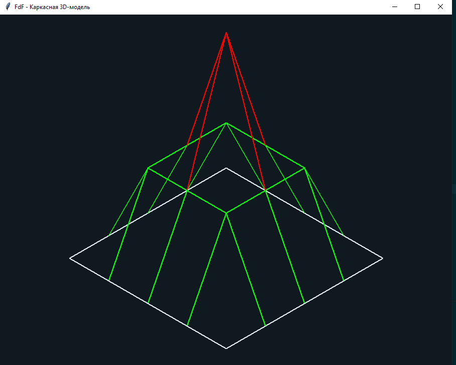

# FdF — каркасная 3D-модель карты высот



## Описание

Программа предназначена для отображения каркасной трёхмерной модели карты высот в изометрической проекции.

Проект реализован на Python с использованием графической библиотеки tkinter.

## Установка и запуск

Для работы программы требуется Python 3.12 или новее.

### 1. Создание виртуального окружения

```powershell
python -m venv .venv
```

### 2. Активация виртуального окружения

```powershell
.venv\Scripts\Activate.ps1
```

### 3. Установка зависимостей

```powershell
python -m pip install -r requirements-dev.txt
```

### 4. Запуск программы

```powershell
python main.py maps/elem.fdf
```

## Управление

| Клавиша или действие | Результат |
|---|---|
| NumPad `+` | Увеличение масштаба модели |
| NumPad `-` | Уменьшение масштаба модели |
| `←` | Перемещение модели влево |
| `→` | Перемещение модели вправо |
| `↑` | Перемещение модели вверх |
| `↓` | Перемещение модели вниз |
| Esc | Завершение программы |
| Закрытие окна | Завершение программы |

## Формат карты

Входные данные представляют собой текстовые файлы с расширением `.fdf`.

Каждая строка соответствует ряду точек карты. Позиция числа в строке определяет координату X, номер строки — координату Y, а само число задаёт высоту Z.

Пример карты:

```text
0 0 0 0 0
0 2 2 2 0
0 2 5 2 0
0 2 2 2 0
0 0 0 0 0
```

Поддерживаются:
- Положительные и отрицательные целые значения высоты.
- Несколько пробелов между значениями.
- Цвета точек в шестнадцатеричном формате, например `2,0xFF0000`.
- Короткая запись цвета, например `2,0xff`.

**Особенности формата:**

- Все строки должны содержать одинаковое количество значений.
- Пустые строки в конце файла игнорируются.
- Цвет может быть указан только у некоторых точек.
- Цвет хранится в виде строки `#RRGGBB` в верхнем регистре либо `None`.
- Ведущие нули допускается опускать.

**Обработка ошибок:**

- Пустой файл, нечисловые значения, неправильные цвета и строки разной длины приводят к ошибке `MapFormatError`.
- При ошибках, связанных с конкретным значением или строкой, сообщение содержит номер строки и колонки.
- Отсутствие файла вызывает стандартную ошибку `OSError`.

## Структура проекта

| Файл или каталог | Назначение |
|---|---|
| `fdf/` | Основные модули программы |
| `fdf/model.py` | Модель точек и карты |
| `fdf/parser.py` | Чтение и проверка файлов `.fdf` |
| `fdf/errors.py` | Классы ошибок |
| `fdf/projection.py` | Изометрическая проекция и камера |
| `fdf/app.py` | Графический интерфейс |
| `maps/` | Файлы карт высот |
| `tests/` | Автоматические тесты |
| `docs/` | Скриншоты приложения |
| `main.py` | Главный файл запуска программы |

## Тесты

Для запуска автоматических тестов:

```powershell
pytest -q
```

Проверка аннотаций типов:

```powershell
mypy --strict fdf main.py
```

Проверка качества кода:

```powershell
ruff check .
```

## Лицензия

Для проекта отдельная открытая лицензия не выбрана.
